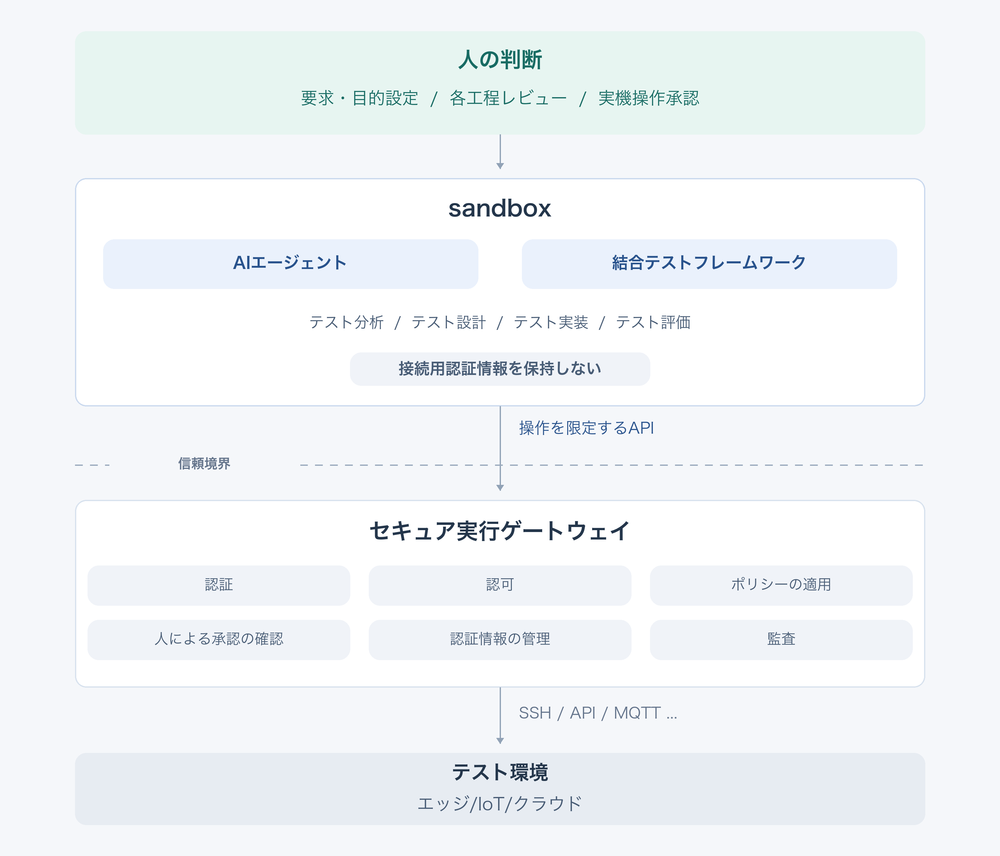
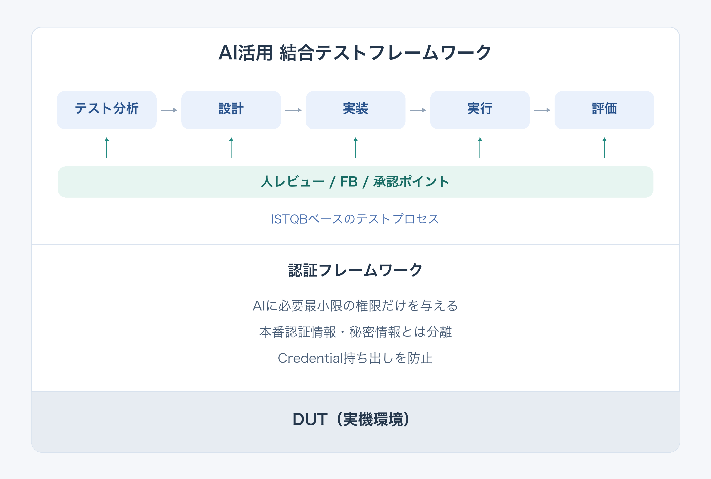

## はじめに

組込み開発では実装したものを実機確認するところで、予想以上に時間を使うことがあります。

エッジ側のアプリケーション、デバイスとの通信、クラウドとの連携、異常時の処理。単体では動いていても、組み合わせると「想定した起動シーケンスと違う」「通信が切れたときの状態が違う」などの想定外がよく出てきます。

で、結合テストを自動化しようとすると、今度は仕様を読んで、ケースを作って、期待値を決めて、スクリプトを書いて、実機で動かして、結果を整理することになります。仕様変更が入れば、そこをまた追いかける。スクリプトが自動で動いても、その前後に結構な作業が残るんですね。

この一連の流れを、生成 AI に手伝ってもらえないか。というのが、今回考えている結合テスト自動化フレームワークの出発点です。

ただ、実機を操作するところまで任せるなら、AI に渡す情報や権限も合わせて考える必要があります。そこで、テストの進め方と実機操作の責務を整理しながら、3回に分けて構想をまとめてみます。

| 回 | テーマ |
|------|------|
| 第1回（今回） | AI を活用した結合テスト自動化フレームワークの全体像 |
| 第2回（予定） | AI × ISTQB：テスト工程と成果物のつながり |
| 第3回（予定） | AI × 認証基盤：認証情報と実行権限の分離 |

本シリーズは、特定企業の構成や機密情報を使わず、独立した Reference Architecture（参照アーキテクチャ）として整理するものです。現時点では設計の構想で、実装や効果を検証した記事ではありません。

---

## 自動化したいのは、仕様から結果までの流れ

結合テストで手間がかかるのは、実行ボタンを押すところだけではありません。

仕様のどこを確認するかを決めて、入力条件と期待値を考えて、それを実行できる形に落とす。結果が NG なら、製品の問題なのか、テストの作り方の問題なのか、環境が整っていなかったのかを確認する必要があります。

さらに仕様が変わると、テストケースとスクリプトも見直します。ここが追いつかないと、「このスクリプトは今の仕様を確認しているんだっけ」という状態になりがちです。

なので、今回のフレームワークでつなぎたいのは、この流れです。

```text
要求・機能仕様
    ↓
テスト観点・条件
    ↓
テストケース・期待結果
    ↓
テスト手順・スクリプト
    ↓
テスト実行
    ↓
結果の記録・評価
```

AI には、それぞれの成果物の作成に加えて、変更の影響を整理し、関連する成果物へ反映する作業も支援してもらいます。

例えば仕様が変わったときは、どのテスト観点やケースを見直す必要があるかを整理する。レビューで期待値が変わったときは、対応するスクリプトを見直して、再テストにつなげる。結果から元のケースや仕様へ戻れるようにしておくことも、この流れに含めます。

ここがつながっていれば、人は変更内容と確認すべき差分に集中しやすくなると思っています。

---

## 修正の効果を確認し、デグレを早く見つける

このフレームワークで特に良いと考えているのが、修正前と修正後を同じテストで比較しやすくなることです。

例えば、特定の入力や処理の組み合わせで重大な脆弱性が見つかったとします。その問題を再現する条件をテストケースにしておけば、修正前には問題を検出でき、修正後には期待する動作になることを、同じ条件で確認できます。小さな修正でも影響が大きいことはあるので、前後の違いを結果として残せるのは大事です。

で、修正した箇所が直っていても、それで確認が終わるわけではありません。周辺の処理や、これまで動いていた機能に影響が出ていないかも確認したいところです。

ここで、修正箇所の確認と、既存の結合テストを繰り返す回帰テストを組み合わせます。

| 確認したいこと | テストの役割 |
|------|------|
| 見つかった問題が修正されたか | 問題を再現するテストで、修正前後の動作を確認する |
| 修正によって別の機能が壊れていないか | 既存の結合テストを再実行し、影響を確認する |
| 後の変更で同じ問題が再発していないか | 再現テストを回帰テストに組み込み、継続して確認する |

一度作ったテストをその場限りにせず、変更のたびや定期的なタイミングで回していく。そうすれば、後から別の修正が入ったときにも、テストで確認している範囲のデグレを早い段階で見つけやすくなります。

毎回、人が手順を思い出して実機で確認していると、どうしても確認できる頻度に限界があります。自動で繰り返せる形にしておけば、「直ったことの確認」と「直った状態を保てているかの確認」を続けやすくなるんですね。

AI には、見つかった問題をテストケースへ落とし込む作業や、関連するケースの見直し、結果の比較を支援してもらいます。比較の基準になる期待値は人がレビューし、実測値に合わせて変えないようにします。こうしてテストを蓄積し、定常的に回していけることが、この構想で狙っているメリットです。

---

## 人・AI・実行基盤で役割を分ける

一連の流れを自動化するとしても、全部の判断を AI に持たせる構成にはしませず、まずは役割を次のように分けます。

| 担当 | 主な役割 |
|------|------|
|  ヒト| 要求・目的の設定、各工程のレビュー、実機操作の承認、最終的な評価 |
| AI Agent | テスト観点・ケース・スクリプトの作成支援、変更点の整理、結果の考察 |
| 結合テストフレームワーク | テスト手順の進行、操作の要求、結果の収集・整理 |
| 実行基盤 | 操作の許可判断、認証情報の管理、テスト対象への操作、操作記録 |

AI が作った期待値を、人が確認する。確認したテストをフレームワークが進め、対象への操作は実行基盤が受け持つ。返ってきた結果を AI が整理し、人が評価する、という分担です。

AI Agent と結合テストフレームワークも、役割としては分けて考えています。AI はテストを組み立てたり解釈したりする部分、フレームワークは手順を進めて結果を集める部分です。

---

## 全体の構成

モジュール関連図にするとこんな形になります。



図の矢印は操作要求の流れを示しています。実行結果は Gateway を通して Sandbox 側へ戻し、評価に使います。人の実機操作承認は、Gateway 側で確認します。

### Sandbox：AI とテストフレームワークを動かす

AI Agent と結合テストフレームワークは、Sandbox の中に配置します。ここでいう Sandbox は、外部へアクセスできる範囲を制限した実行環境です。

この中でテストを分析・設計・実装し、実行結果を評価します。テストを進める際も、対象へ直接接続する権限は持たせず、必要な操作を外側へ要求します。

図の「接続用認証情報を保持しない」は、テスト対象に接続するための SSH 鍵やパスワードなどを、この中に持たせない方針を表しています。

### Capability API：要求できる操作を限定する

Sandbox と外側をつなぐ窓口が Capability API です。ここでいう Capability は、AI 側が実行を要求できる操作、くらいの意味です。

あらかじめ定めた操作を、この窓口から要求します。AI が必要だと考えた操作なら何でも通る、という窓口にはしません。

### Secure Execution Gateway：許可を確認して対象を操作する

実行基盤の中心になるのが、Sandbox の外に置く Secure Execution Gateway です。

要求元の確認、操作権限の確認、ポリシーの適用、人の承認確認を行い、許可した操作をテスト対象へ渡します。接続用認証情報の管理と操作の記録も、こちらの責務です。

図の「信頼境界」は、AI 側の要求をそのまま信用せず、実行側で確認する切れ目を示しています。AI が操作を提案することと、その操作を実行してよいことを線引きしています。

### Test Environment：結合テストを行う環境

対象は IoT デバイス、エッジ側のソフトウェア、クラウド側のサービスなどを想定しています。図の SSH／API／MQTT は、対象に応じた接続手段の例です。

毎回この全部をつなぐ、という意味ではありません。何と何のつながりを確認するかは、テストの目的に合わせて決めます。

テスト実行は Sandbox 内のフレームワークによる進行管理と、Gateway による対象操作に分かれます。このため、図では Test Execution を一つの箱にまとめていません。

---

## レビューは、最後だけにしない

AI に最初から最後まで進めてもらって、最後に結果表だけ確認する。これだと、最初の要求の読み違いまで、そのまま下流へ流れる可能性があります。

期待値が間違っていても、その期待値に合うスクリプトと結果表ができていれば、一見すると筋が通って見えてしまいます。

なので、人が判断に入る Human-in-the-Loop（HITL）のポイントを、各工程に置きます。分析では観点、設計では期待値、実装では設計との整合、実行では操作内容と承認、評価では結果の根拠を確認します。

テストプロセスと、それを下支えする認証基盤を重ねると、こんな形になります。



上段では、テスト分析から評価までの各工程に、人のレビューや承認を挟みます。中段の認証フレームワークは、先ほどの Gateway を中心とした認証・認可の基盤です。AI 側が要求できる操作を必要な範囲に限定し、テスト対象への接続用認証情報は Gateway 側で管理する方針を表しています。

第二回では上段のテストプロセスを、第三回では中段の認証・実行権限の管理を掘り下げます。

レビューで修正が必要になったら、該当する工程へ戻します。そこで変わった内容を、必要な下流の成果物にも反映してから進めます。

図はテストを作成・変更するときの基本の流れです。定常的な回帰テストでは、レビュー済みのテストを承認された実行範囲で繰り返し使い、ケースや期待値、操作範囲を変更する場合に、関係する工程を再レビューする考え方です。

工程の整理には、ISTQB のテスト活動の考え方を参考にします。各工程で何を作り、何をレビューして次へ渡すか。このつながりを、第二回で扱う予定です。

---

## 実機操作を任せるための境界も、最初から用意する

もう一つ、全体の構成で先に決めておきたいのが、認証情報と実行権限の置き場所です。

AI に「認証情報を読まないで」「許可した操作だけ実行して」と指示するだけでは、実行基盤としての制限にはなりません。AI が動く環境から認証情報へ触れず、対象への操作は Gateway を通る構成にしておく必要があります。

それから、認証情報を隠すことと、操作を制限することも別です。鍵が見えなくても、Gateway に何でも実行させられるなら、実機への権限は広いままになります。

なので、接続用認証情報の管理に加えて、「誰が、何を要求できるか」「人が承認した操作か」を Gateway 側で確認する方針です。この役割分担と信頼境界を、第三回で整理します。

Gateway を置いただけで安全性が決まるわけではありませんが、どこが操作を許可し、どこが認証情報を扱うかを、構想の段階ではっきりさせておきたいと考えています。

---

## おわりに

今回目指しているのは、仕様からテスト結果までのつながりを保ちながら、生成 AI に結合テストを支援してもらうフレームワークです。

脆弱性や不具合が見つかったときに、修正前後の違いを同じテストで確認する。そのテストを回帰テストとして残し、定常的に実行してデグレを早く見つける。このサイクルを続けやすくすることが、狙いの一つです。

AI にはテストの作成や変更への追従、結果の整理を手伝ってもらう。人は各工程をレビューし、実機操作を承認する。対象への操作と認証情報は、Sandbox の外に置いた Gateway が受け持つ。この分担を基本にしています。

何を AI に任せて、どこで人が判断し、どこで操作を制限するかが見えると、フレームワークとして考える範囲も整理しやすくなります。

次回は、この構成の中でテストをどう進めるかを、AI × ISTQB の観点からまとめてみたいと思います。
