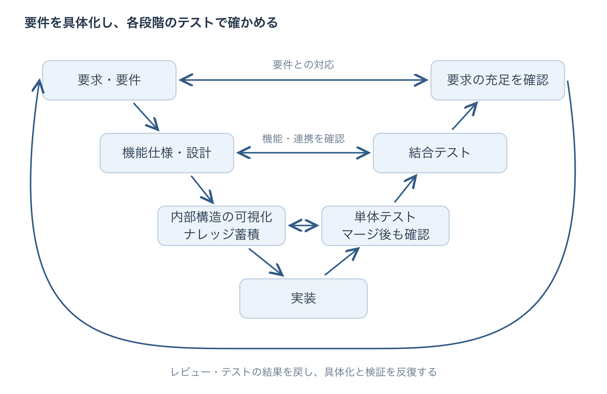
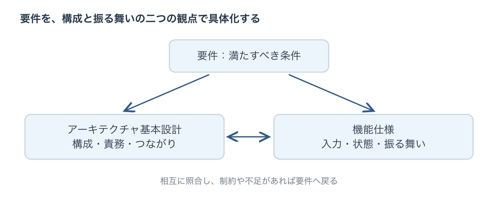
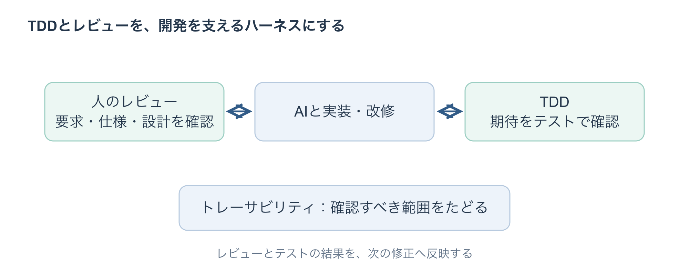
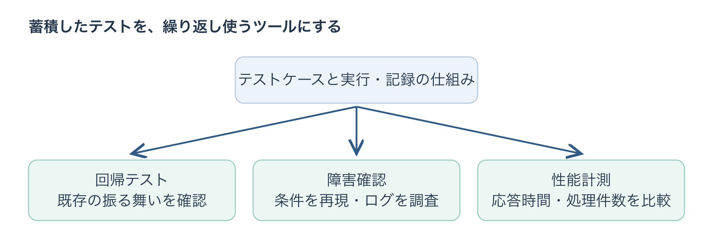

## はじめに

こんにちは。Shizen ConnectのSato Toshiakiです。

組み込み開発では、実機や周辺機器との連携、通信状態も含めた確認が必要です。私はこの確認を開発中に繰り返し使えるツールにするため、結合テスト自動化フレームワークを構築して運用しています。

要件・仕様・設計・実装・テストを対応付け、AIによるテスト作成や結果整理も活用しながら、複雑な機能を作り込んでいます。本記事では、その進め方と、テストを開発のツールとして使う工夫を紹介します。

## 具体化と検証を反復し、抽象を形にする

ここでは、抽象の側を、解決したいビジネス課題や要求、それを整理した要件として捉えます。それを仕様・設計・実装へ具体化し、テストで確かめます。矛盾や不足が分かれば要求や仕様へ戻る。この具体化と検証を、人のレビューを挟みながら反復しています。

要件の具体化では次の二つを分けて考えます。

- **アーキテクチャ基本設計**：全体の構成と役割分担
- **機能仕様**：各機能の入力・状態に対する振る舞い

例えば、計測データを送る機器に「主回線が途絶しても、副回線でデータを欠損・重複なく届けたい」という要求があるとします。この要求を次のように具体化していきます。

※以下は説明のための仮想例です。

| 観点 | 決めることの例 |
|---|---|
| 要件定義 | 対象とする通信断、許容する切り替え時間、欠損・重複の判定条件 |
| アーキテクチャ基本設計 | エッジ側で切り替えと保存・再送、クラウド側で重複排除を担う |
| 機能仕様 | 主回線の途絶を判定して副回線へ切り替え、未送信データを再送する。同じ識別子のデータは重複登録しない |

この例では、副回線が利用できることを前提にします。切り替え時間や保存容量の制約で成立しなければ、要件や仕様へ戻って調整します。

AIには案出しを支援してもらいますが、私の経験では、誤った説明や矛盾が含まれ、修正案にも確認が必要なことがあります。重要な設計は、根拠や制約をチームでレビューしています。

## トレーサビリティで、変更と進捗をたどる

要件から仕様・設計・実装・テストまでの対応をたどれることが、トレーサビリティです。その対応を表にまとめたトレーサビリティマトリクスを使っています。

| 要件 | 仕様・設計 | 実装・PR | テスト |
|---|---|---|---|
| 副回線で欠損・重複なく届ける | 切り替え・保存・再送・重複排除の振る舞いと役割分担 | 各処理の実装と変更差分 | 切り替え時間と、各端末の状態と送受信データを確認 |

人手で対応を洗い出し、変更のたびに更新するのは負担です。こうした対応付けや変更箇所の整理こそ、AIの支援を生かしやすい作業だと考えています。AIが作った案の根拠を人が確認し、更新に使います。

成果物の状態や予定日も整理すれば、要件ごとの進捗や残作業を把握できます。変更時に何を確認し直すか、人が開発進捗をどう判断するか、その両方に役立ちます。

## 要件を確認するテストを先に作り、TDDで改修を支える

実装の前に、「何を確認できれば要件を満たしたと言えるか」をテストにします。

回線切り替えの例なら、主回線を切断し、仕様で定めた時間内に副回線へ切り替わることを確認します。さらに各端末の状態と送受信データを記録し、識別子・件数を照合して欠損・重複を確かめます。期待結果は、実測値ではなく要件や仕様を根拠に決めます。

先にテストを書き、失敗を確認し、それを満たす実装を進める。通ったら振る舞いを保ったまま内部構造を整える。この繰り返しが、テスト駆動開発（TDD）です。結合テストに加え個々の処理を確認するテストも使います。

特に、AIによるブランチ間のマージでは、単体テストが有効だと感じています。構文上はマージできても、必要な処理が失われたり、別の変更で振る舞いが変わったりすることがあります。マージ後に単体テストを実行すれば、テストで確認している範囲の誤りを検出し、そのまま取り込むのを防ぐ手がかりになります。

既存の実装をリファクタリングする際も、必要なテストを先に整えます。再送処理を別のモジュールへ移しても、データが欠損・重複なく届くという期待結果は変わりません。トレーサビリティで確認範囲をたどり、テストで改修結果を確かめます。

### TDDとレビューをハーネスにする

AIとの対話で実装を進めるバイブコーディングでは、TDDと人のレビューをハーネスとして使っています。テストで振る舞いを確かめ、レビューで「そのテストが要件を確認できているか」を判断する仕組みです。

冗長化した回線の例では、主回線の途絶から副回線への切り替え、その後の状態遷移を、先にテストで定めます。実装・改修のたびに実行し、期待しない状態へ遷移したり、想定した状態から進まなくなったりする逸脱を早期に検出します。一方、人のレビューでは、遷移条件や期待する状態そのものが要件に沿っているかを確認します。テストとレビューの両方で、実装と期待結果のずれを小さいうちに見つけ、修正につなげます。

こうしてAIを使う処理に人の判断を組み込む考え方を、Human-in-the-Loop（HITL）と呼びます。

## フレームワークで、確認を繰り返せる形にする

私が作ったフレームワークでは、テスト手順の進行と結果の収集・記録を担います。AIはケースや手順の案、結果の整理を支援し、人は妥当性を判断します。

| テストに残すもの | 回線切り替えの例 |
|---|---|
| 条件と手順 | 副回線が使える状態でデータを送信し、主回線を切断する |
| 期待結果 | 規定時間内に切り替わり、対象データに欠損・重複がない |
| 実行記録 | 機器の状態、設定、ソフトウェアの版、切り替え時間、送受信データ、ログ |

結果はケースと仕様に対応付けます。切り替え条件や許容時間が変わったら、手順と期待結果も見直し、再レビューして実行します。

副回線への切り替えがうまくいかず重複（主副回線が同時にACTIVEになることをスプリットブレインといいます）となった場合も、再現条件を残して同じ手順を実行します。修正前に問題を検出できること、修正後に期待結果を満たすこと、関連する既存機能に影響がないことを確認します。そのケースは回帰テストに組み込み、後の変更でも繰り返し使います。

## 回帰テストを、障害確認や性能計測のツールにする

ここで推したいことは、蓄積したテストを、開発中に繰り返し使えるツールにできることです。

- **回帰テスト**：変更後も既存の振る舞いが保たれるか確認する
- **障害確認**：回線切り替えを再現し、ログを調べ、修正案を比較する
- **性能計測**：切り替え所要時間や、未送信データの送信完了までの時間を比較する

回帰テストは、既存の振る舞いを確かめながら、積極的にリファクタリングを進める支えになります。
障害確認では、市場で発生したインシデントを再現ケースと結び付け、修正の効果と再発の有無を確認します。
性能計測では、処理ごとの計測結果から改善が必要なモジュールを絞り込み、変更前後を比較します。
こうして蓄積したテストを、製品を継続的に改善するためのツールとして使いながら反復開発することができます。

## まとめ

要件を具体化しテストで確かめ結果を次の改修へ戻す。この反復を、トレーサビリティ、TDDとレビュー、結合テストフレームワークで支えています。テストを蓄積することで障害確認や性能計測にも繰り返し使えます。

今後は、開発現場の要件や実機環境に合わせてこうした仕組みづくりの外部支援にも取り組んでいければと思います。

最後まで読んでいただきありがとうございました。

## 参考記事

- [IBM「ヒューマン・イン・ザ・ループとは」](https://www.ibm.com/jp-ja/think/topics/human-in-the-loop)：HITLの考え方と、人による監督・判断の役割についての解説。
- [JSTQB「Foundation Level シラバス 日本語版」](https://www.jstqb.jp/dl/JSTQB-SyllabusFoundation_VersionV40.J02.pdf)：JSTQBのテストプロセス、テスト活動と成果物の関係を参照できる公式日本語資料。
- [VDA QMC「Automotive SPICE® プロセス参照モデル／プロセスアセスメントモデル Version 4.0 日本語版」](https://vda-qmc.de/wp-content/uploads/2024/02/Automotive-SPICE-PAM_40_Japanese-1.pdf)：要求分析、アーキテクチャ設計、実装、検証と、成果物間のトレーサビリティを考える際の参考資料。
